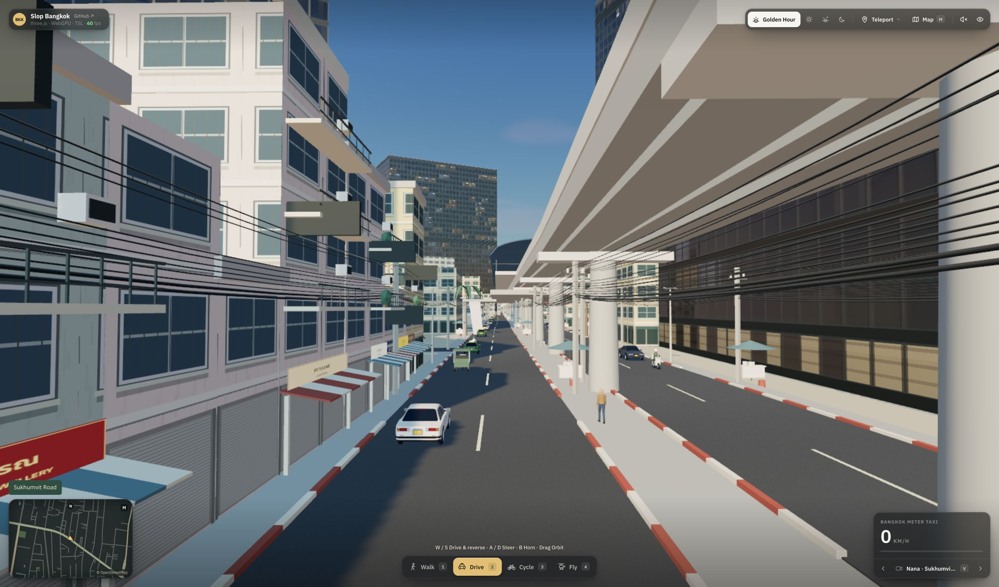

# Slop Bangkok

A stylized, playable Bangkok remix of [mrdoob's Slop New York](https://github.com/mrdoob/slop-newyork), built with three.js, WebGPURenderer, and TSL. Walk, drive a meter taxi, cycle, or fly a helicopter through central Bangkok.



## Run locally

No install or build step is required. Serve this directory over HTTP:

```sh
python3 -m http.server 5173
```

Open <http://localhost:5173>. A current browser with WebGPU or WebGL 2 is required. The first visit downloads three.js and fonts and compiles shaders. Three.js is pinned to commit `fa57cf648fc36a9c5999f0076bfeea4960de50f6`.

## Explore

- **WASD / arrow keys** move and steer. Drag to orbit; scroll or pinch to zoom.
- **1–4** switch between walking, driving, cycling, and flying.
- **Space / E** ascend in the helicopter; **Q / C** descend. Space jumps while walking.
- **V / Shift+V** cycle cameras. **M** opens the searchable map. Click a street to teleport.
- **N** toggles synthesized engine audio; **B** sounds the horn. **H** hides the HUD.
- Touch joystick and action buttons appear on touch devices. Standard gamepads use the original control system.

The initial street view starts near Nana on Sukhumvit Road. Painted-concrete shophouses replace the original Manhattan brick facades. Featured streets include modeled balconies, shutters, shop awnings, utility cable bundles, red-and-white curbs, food carts, scooters, tuk-tuks, two-tone taxis, and pedestrians. Mapped BTS viaducts connect modeled stations and animated trains.

The teleport menu includes Mahanakhon, Wat Arun, the Grand Palace, Yaowarat, Lumphini Park, Siam Square, Baiyoke Tower II, ICONSIAM, and Asok. Scenic cameras provide landmark views, including a Nana / Sukhumvit BTS view. Speed and altitude use km/h and metres. Player positions are saved locally under a Bangkok-specific key.

## Geography and scope

The checked-in snapshot covers approximately **13.700–13.775° N, 100.475–100.585° E**, from Thonburi and the old town to Sukhumvit. It includes **11,295 road ways**, **87,953 mapped building outlines**, waterways, parks, and 73 elevated rail ways plus 21 station nodes, fetched from OpenStreetMap on 26 October 2026. World coordinates use metres, east = +x and north = −z, with an origin at Sala Daeng.

Road alignments and building locations come from the snapshot. Buildings are simplified bounding volumes; missing heights and additional street-front buildings are procedural. Landmarks are stylized models. River widths are approximated from mapped centerlines, not surveyed bank geometry. The scene is an exploration prototype, not a navigation or engineering map.

Traffic is decorative, follows mapped roads on the left, and loops along connected road ways. It does not simulate intersections, traffic signals, routing, or collisions with the player. Elevated road bridges are rendered at ground level. BTS railway viaducts are elevated; station architecture and train movements are stylized, without timetable simulation. Water does not have swimming or buoyancy physics. The inherited New York geography modules and data remain in the fork for reference but are not loaded by the Bangkok entry point.

City geometry is split into spatial chunks and distant street detail is hidden. Rendering resolution is capped at 1,600 pixels wide; frame rate depends on the device and camera position.

## Refresh the snapshot

The generated `js/bangkok-geodata.js` is checked in, so browsing makes no requests to OSM servers. The raw download is ignored by Git.

```sh
# Bounded, cached map-API fallback when Overpass is unavailable:
python3 tools/fetch-bangkok.py
node tools/build-bangkok.mjs
```

Alternatively, use `tools/data/q_bangkok.overpassql` with an available Overpass endpoint, save its JSON to `tools/data/osm_bangkok.json`, and run the builder. The map-API fallback caches tiles in `/tmp/slop-bangkok-osm` and requests at most four tiles concurrently.

## Verify

```sh
node --test tests/*.test.*
```

The suite covers the inherited controller/camera/vehicle systems and Bangkok projection, map lookup, and teleport arrivals. Browser checks should also cover all four modes, landmark teleporting, time presets, map search, and a mobile viewport.

## Visual references

Street proportions and architectural details were checked against [Sukhumvit street photography](https://visitbangkok.co.uk/bangkok/neighborhoods/sukhumvit), [Song Wat shophouses](https://www.timeout.com/bangkok/attractions/song-wat), and the [official BTS route description](https://btsapp1.bts.co.th/website/eng/library/system-structuer.html). Reference photos are not bundled in the project.

## Credits and license

Original simulation by [mrdoob](https://github.com/mrdoob). Code is available under the [MIT License](LICENSE).

Geographic data © [OpenStreetMap contributors](https://www.openstreetmap.org/copyright), available under the [Open Database License](https://opendatacommons.org/licenses/odbl/). The Bangkok snapshot is a derived OSM database distributed under ODbL. Original NYC Open Data and OSM data retain their respective licenses. Third-party dependencies and fonts retain their licenses.
